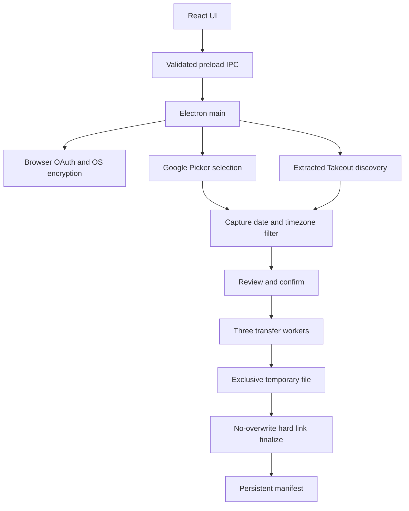

# Architecture and contracts

React renders local bundled UI under a restrictive CSP. Sandboxed, context-isolated preload exposes only folder selection, sign-in/out, Picker, preview/start/cancel and progress subscription. Main validates the sender frame, options, API responses and external URLs. Renderer cannot choose arbitrary transfer URLs or filesystem paths. New windows, external navigation and permission requests are denied. Fixed Google authentication endpoints and validated Google Picker/media hosts are opened or fetched by main.

Modules: `auth.ts` handles OAuth and encrypted storage; `picker.ts` handles sessions and pagination; `takeout.ts` handles local discovery; `organization.ts` handles dates and names; `engine.ts` handles bounded transfers and persistence; `network.ts` handles timeouts and retries. There are three transfer workers, four retries after an initial attempt, exponential delays and Retry-After support for temporary HTTP failures. Each HTTP header fetch has a 60-second timeout. Stream stalls and sleep behavior still require live qualification.

Takeout discovery runs in a separate Node worker through `discovery.ts` and `takeout-worker.ts`. Cancellation terminates the worker, isolating filesystem enumeration and CPU-heavy metadata parsing from the Electron main event loop. The worker returns only discovered media or a sanitized error message; it has no authentication credentials.

## Manifest version 1

`<userData>/manifest.json` is a JSON object with `version: 1` and `records`, keyed by SHA-256 of account scope, media ID, absolute destination and timezone. Each record has `target` (relative path), `hash` (hex SHA-256), and `size` (bytes). A Takeout media ID derives from its absolute source path; renamed/moved sources have different IDs, but matching target contents can be reused. Account scopes isolate Google identifiers. Date range and video toggle do not change file identity.

One app instance and an exclusive `job.lock` prevent simultaneous manifest writers. Manifest writes are serialized through a temporary file and rename. Unsupported/corrupt versions stop the job. No migrations exist yet: back up application data before upgrades; do not silently downgrade a future manifest.

Transfers create exclusive `.gphotos-UUID.part` files in the target month, compare Content-Length when meaningful (or local source length), calculate SHA-256 and fsync before hard-linking into an available final path. Hard links provide no-overwrite finalization on supported filesystems; there is no unsafe overwrite fallback. Manifest is written after finalization. After a crash before persistence, matching existing contents can be recognized when retrying. Crash-left temporary files and a stale lock require manual recovery; no automatic garbage collection is implemented.

## Privacy and limitations

No application log file or telemetry is enabled. Manifest and UI errors can contain private filenames and paths. There is no API content authenticity proof, global cross-folder deduplication, hostile-tree race guarantee or full power-loss durability guarantee. Root/component symlinks are checked for output creation, but checks cannot eliminate concurrent filesystem mutation races. Use stable, user-controlled local directories.
